# Architecture: "Hei Äiti" / HeyMom — a quiet daily hello for a parent living alone

> Junction hackathon · If P&C Insurance challenge · Stack: React Native (Expo) + Supabase (EU)
> Status: design only, no code yet. Vendor/platform claims marked ⚠️ need verification before relying on them.

## 0. Concept in one paragraph

Aino, 74, recently widowed, lives alone in Turku. Her daughter Laura, 45, lives in Helsinki and is the If customer. The app notices *silence*: Aino's normal daily activity (electricity pattern, kettle plug, a big "I'm OK" button, or an automated voice call) counts as proof of life. If the expected proof doesn't arrive, a gentle escalation starts — Aino first, then Laura. A second mode watches Aino's **empty home** (e.g. while she's in hospital) during hard freezes to prevent freeze/water damage. *One app watches both Mom and Mom's home.* Not an emergency service — it detects "nobody knows help is needed"; humans and 112 respond.

## 0.1 Decisions at a glance

| Area | Decision |
|---|---|
| RN flavour | **Expo (managed) + dev builds (EAS) + config plugins**, expo-router |
| Apps | **One app, two role shells** (Aino / Family). Aino may also be **app-less** (meter + voice only) |
| Backend | **Supabase, EU region (Stockholm eu-north-1; Frankfurt fallback)**: Postgres + RLS, Edge Functions (Deno), pg_cron, Realtime |
| Engine | **Pure TypeScript state machine** in `packages/core` with injected `Clock`; executed by a cron *tick* with compare-and-swap transitions and an **outbox** for side effects |
| Alarm model | **Single alarm path.** Signals produce *proof-of-life* events; only **absence of proof** within a learned window can start escalation, and escalation always contacts Aino first |
| Property (empty home) | Separate **low-urgency "home check"** task, only in `away` mode; never pages about Aino's wellbeing |
| Baseline | **Robust quantiles** (P10/P50/P90 + IQR) per day type over 14 days. No ML |
| Notifications | Expo push (primary), email, Telegram (demo/optional), SMS (paid fallback for unacked alerts only) |
| Voice | `VoiceProvider` adapter: **46elks (SE, EU) default** ⚠️, Twilio alternative, **Mock** for tests/demo |
| Weather | `WeatherProvider` adapter: **FMI open data (FI)**, MET Norway pan-Nordic fallback; server-side cache per grid cell; demo override |
| Meter | `MeterAdapter` per country. Datahub data is **retrospective** (baseline + property watch); real-time proof comes from **HAN-port reader or smart plug**. Hackathon: CSV replay |

> **Credibility point (say it openly in the pitch):** Fingrid Datahub consumption data typically arrives with a delay (≈ next day) ⚠️, so it cannot be a real-time "she's up" signal. We use it to *learn the routine* and *watch the empty home*. Live proof comes from a local meter **HAN-port reader** (many Finnish 2nd-gen meters have one — check with the DSO ⚠️) or a kettle smart plug. In the demo, CSV replay stands in for a HAN reader.

---

## 1. Architecture overview

```mermaid
flowchart LR
  subgraph DEV_AINO["Aino's home / device (trust zone A: data subject)"]
    A1[Aino shell: big 'I'm OK' button<br/>local backup reminder]
    A2[HAN reader / smart plug<br/>(sim: CSV replayer)]
    A3[Any phone<br/>(voice IVR)]
  end
  subgraph DEV_FAM["Family device (trust zone B: recipient)"]
    L1[Family shell: status G/Y/R/Grey<br/>ack / resolve]
  end
  subgraph EU["Supabase EU project (trust zone C: controller backend; separate from If core)"]
    I[ingest-signal fn<br/>validate + dedupe + consent gate]
    DB[(Postgres + RLS<br/>signals 30d, features 90d,<br/>baselines, escalations, outbox, audit)]
    T[tick fn (pg_cron 1 min)<br/>core engine]
    BL[baseline-nightly fn]
    PW[property-watch fn]
    W[weather-refresh fn (hourly)]
    D[notify-dispatch fn<br/>outbox -> channels]
    VW[voice-webhook fn]
    HV[status view<br/>(minimised)]
  end
  subgraph EXT["Third parties (trust zone D: processors / open data)"]
    FMI[FMI / MET Norway open data]
    DH[Fingrid Datahub / Elhub / Eloverblik]
    PUSH[Expo push -> APNs/FCM]
    VOICE[46elks / Twilio]
    MAIL[EU email / Telegram]
    WD[External watchdog<br/>(uptime pinger)]
  end
  subgraph IF["If P&C (trust zone E)"]
    KPI[Aggregate KPIs only<br/>k>=10, no person-level data]
  end

  A1 -- proof events --> I
  A2 -- activity events --> I
  DH -. daily batch (post-hack) .-> I
  I --> DB
  T <--> DB
  BL <--> DB
  PW <--> DB
  W --> FMI
  W --> DB
  T -- enqueue --> DB
  D -- read outbox --> DB
  D --> PUSH --> A1
  D --> PUSH --> L1
  D --> VOICE --> A3
  VOICE -- DTMF result --> VW --> DB
  D --> MAIL
  L1 -- reads only --> HV
  WD -- /health --> T
  DB -. anonymised aggregates .-> KPI
```

**Trust-boundary rules**
- **A → C:** only proof events (source, time, strength). Raw meter readings go to a raw table with 30-day TTL.
- **C → B:** only `household_status_v`: status, last proof time, and the escalation step log *during escalation*.
- **C → D:** minimal payloads. Push text = first name + status word. Voice = phone number + TTS script; no recording.
- **C → E:** never person-level data. Separate Supabase project, separate credentials, no If-side DB access.

---

## 2. Monorepo layout (pnpm workspaces, `node-linker=hoisted` for Metro)

```
heymom/
├─ apps/
│  ├─ mobile/                    # Expo app, expo-router
│  │  ├─ app/(onboarding)/       # role pick, invite, consent (Aino-owned), Life Kit setup
│  │  ├─ app/(aino)/             # giant button, today card, "who looked" transparency, stop
│  │  ├─ app/(family)/           # status, alert detail, ack/resolve, away mode, home-check tasks
│  │  └─ src/{signals,local-reminder,api}/
│  └─ demo-console/              # Vite web: sim clock, meter chart ("operator view"),
│                                #   weather override, scenario buttons, live state machine view
├─ supabase/
│  ├─ migrations/                # schema, RLS, views, pg_cron jobs, retention purges
│  ├─ functions/
│  │  ├─ ingest-signal/  tick/  voice-webhook/  notify-dispatch/
│  │  ├─ weather-refresh/  baseline-nightly/  property-watch/  health/  demo-control/
│  │  └─ _shared/core/           # GENERATED copy of packages/core (Deno bundling workaround)
│  └─ seed/
├─ packages/
│  ├─ core/                      # domain types, escalation machine, baseline, window calc, Clock. Zero deps
│  ├─ adapters/                  # SignalAdapter impls: button, app-open, voice-ivr, smart-plug,
│  │                             #   meter-sim, meter-fi-datahub (stub), meter-han (stub)
│  ├─ weather/                   # FMI WFS client + MET Norway + slippery/freeze derivation
│  ├─ notify/                    # Channel: expo-push, email, telegram, sms; VoiceProvider: 46elks/twilio/mock
│  ├─ kits/                      # Life Kits engine (JSON rules evaluator); optional
│  ├─ i18n/                      # fi, sv, en (+ TTS scripts per locale)
│  └─ ui/                        # accessible components: BigButton, StatusBadge (colour + text + icon)
├─ kits/parent-living-alone.v1.json
├─ data/sim/                     # aino_60d_1min.csv, scenarios/*.json
└─ scripts/sync-core.ts          # copies packages/core -> supabase/functions/_shared/core
```

---

## 3. Core domain model (`packages/core/src/types.ts`)

```ts
type ISO = string;                      // UTC ISO-8601; local logic uses household.timezone
type Country = 'FI' | 'SE' | 'NO' | 'DK';
type Locale = 'fi' | 'sv' | 'en';

interface Household {
  id: string; country: Country; timezone: string;           // 'Europe/Helsinki'
  weatherCellId: string;                                     // coarse grid cell, not an address
  mode: 'active' | 'away' | 'paused';
  heatingType: 'electric' | 'heat_pump' | 'district' | 'other' | 'unknown';
  kitRef?: { kitId: 'parent-living-alone'; version: number };
  declaredWakeMinute?: number;                               // cold-start prior, e.g. 450 = 07:30
}

type Role = 'monitored_person' | 'family_contact';
interface Person {
  id: string; householdId: string; role: Role; displayName: string; locale: Locale;
  phoneE164?: string; authUserId?: string;
  contactOrder?: number;                                     // 1 = Laura, 2 = sibling/neighbour
}

type ConsentScope =
  | 'service_core' | 'signal:button' | 'signal:app_open' | 'signal:smart_plug'
  | 'signal:meter_live' | 'signal:meter_datahub' | 'channel:voice_call'
  | 'share:last_activity_time' | 'share:location_on_alert' | 'property_watch';
interface Consent {
  id: string; subjectPersonId: string;                       // always Aino
  scope: ConsentScope; granted: boolean;
  noticeVersion: string; noticeHash: string;                 // exact text she saw/heard
  method: 'in_app' | 'ivr' | 'assisted_in_app';
  capturedAt: ISO; withdrawnAt?: ISO;
}

type SignalSource = 'button' | 'voice_ivr' | 'app_open' | 'smart_plug' | 'meter_live' | 'device_activity';
type ProofStrength = 'explicit' | 'passive_strong' | 'passive_weak';
interface SignalEvent {
  id: string; householdId: string; source: SignalSource; strength: ProofStrength;
  occurredAt: ISO; receivedAt: ISO; adapterId: string;
  dedupeKey: string;                                         // adapterId + source-native id/time bucket
}

interface DailyFeature {                                     // derived; raw data can then be purged
  householdId: string; localDate: string; dayType: 'weekday' | 'weekend';
  firstProofMinute: number | null; proofCount: number; meterKwh?: number; hdd?: number;
}

interface Baseline {
  householdId: string; dayType: 'weekday' | 'weekend'; anchor: 'first_activity';
  sampleDays: number; p10: number; p50: number; p90: number; iqr: number;   // minutes of local day
  opensAtMinute: number; deadlineMinute: number;
  source: 'declared' | 'blended' | 'learned'; computedAt: ISO;
}

interface CheckInWindow {
  id: string; householdId: string; localDate: string; anchor: 'first_activity';
  opensAt: ISO; deadlineAt: ISO; graceMin: number;
  adjustments: Array<{ kind: 'weather_icy' | 'weak_signal_extension' | 'user_snooze'; deltaMin: number }>;
  baselineRef: { dayType: Baseline['dayType']; computedAt: ISO };
}

type EscState = 'scheduled' | 'open' | 'satisfied' | 'nudging' | 'calling'
              | 'alerting' | 'acknowledged' | 'resolved' | 'cancelled';
interface EscalationState {
  windowId: string; householdId: string; state: EscState;
  version: number;                                           // CAS
  enteredAt: ISO; nextDueAt: ISO | null;
  attempts: { nudge: number; call: number; alert: number };
  resolution?: 'proof' | 'voice' | 'family_confirmed_ok' | 'family_handled' | 'mode_change' | 'catchup_proof';
  satisfiedByEventId?: string;
}

type AlertKind = 'wellbeing_check' | 'all_clear' | 'home_check' | 'system_degraded' | 'weekly_channel_test';
type Channel = 'push' | 'email' | 'telegram' | 'sms' | 'voice';
interface Alert {                                            // = outbox row
  id: string; householdId: string; windowId?: string; recipientPersonId: string;
  kind: AlertKind; channel: Channel; idempotencyKey: string; // `${windowId}:${step}:${channel}`
  status: 'queued' | 'sent' | 'delivered' | 'failed' | 'acknowledged';
  attempts: number; providerRef?: string; createdAt: ISO; ackAt?: ISO;
}

interface WeatherContext {
  cellId: string; validFrom: ISO; validTo: ISO;
  minTempC: number; maxTempC: number; precipMm: number;
  slipperyRisk: 'none' | 'moderate' | 'high';                // zero-crossing + precip heuristic (+ FMI warnings)
  hardFreeze: boolean;                                       // min <= -15 C within 48 h (configurable)
  source: 'fmi' | 'met_no' | 'override'; fetchedAt: ISO;
}

interface Clock { now(householdId?: string): Date }          // prod: system; demo: sim_clock offset/speed
```

---

## 4. Escalation state machine

```mermaid
stateDiagram-v2
  [*] --> scheduled
  scheduled --> open: now >= opensAt
  open --> satisfied: proof (explicit | passive_strong)
  open --> open: passive_weak -> extend deadline +30m (once)
  open --> nudging: now >= deadlineAt / push + in-app gentle prompt to Aino
  nudging --> satisfied: any proof
  nudging --> calling: +grace (20m; 10m if icy) [voice consent]
  nudging --> nudging: no voice consent -> 2nd nudge, then alerting
  calling --> satisfied: any key pressed / any proof
  calling --> calling: no answer -> retry after 10m (max 2 calls)
  calling --> alerting: 2 calls unanswered / failed
  alerting --> acknowledged: Laura taps "I'm handling it"
  alerting --> alerting: unacked 15m -> contact #2 + SMS fallback
  alerting --> resolved: proof arrives -> "all clear" to Laura
  acknowledged --> resolved: Laura marks outcome / proof arrives
  satisfied --> [*]
  resolved --> [*]
  scheduled --> cancelled: mode away/paused
  open --> cancelled: mode away/paused
  nudging --> cancelled: mode away/paused
```



**Rules**
- **Single entry point to escalation:** `open → nudging` on deadline. No sensor can move a window to `alerting`. Passive signals can only *satisfy* (strong) or *extend once* (weak).
- **Aino first, always.** `alerting` is reached only after ≥ 1 nudge and either (a) 2 unanswered calls or (b) 2 nudges with no voice consent.
- **IVR accepts *any key*** (not only "1"), in Aino's locale, slow speech, repeated twice — fewer false "no answer"s.
- **Timers** live in `nextDueAt`. Weather tightens grace (20 → 10 min) and caps the deadline at `p90 + 15`. It never adds alarms.

**Engine contract** (pure, deterministic, unit-tested by replaying 60 days of simulated data):
```ts
function step(s: EscalationState, w: CheckInWindow, input: EngineInput, now: Date, cfg: Config):
  { next: EscalationState; effects: Effect[] }   // Effect = Nudge | PlaceCall | Alert | AllClear
```

**Idempotency and concurrency**
- `tick` claims due rows with `SELECT … WHERE next_due_at <= now FOR UPDATE SKIP LOCKED LIMIT 500` — scales horizontally, never double-processes.
- Transitions go through SQL function `apply_transition(window_id, expected_version, next_state, effects[])`: CAS on `version`; state update and outbox inserts **in one transaction**.
- Outbox `UNIQUE(idempotency_key)`. Dispatcher is at-least-once and passes the key to providers that support it. Voice webhooks deduped by provider call id.
- Proof ingestion idempotent via `UNIQUE(household_id, dedupe_key)`. Late proof (`occurredAt` inside the window) still counts.

**Fail-safe behaviour** — fail toward asking Aino, never toward silence, never straight to Laura.

| Failure | Behaviour | Surfacing |
|---|---|---|
| Cron/tick stops | `health` fn checks `last_tick_at < 3 min`; external watchdog pings it | Ops paged (team, not families). Laura's status turns **grey "Checking is delayed (last checked 14:02)"**. Green has a 10-min TTL and is never shown stale |
| Backend recovers after outage | Catch-up re-evaluates each missed window using proof `occurredAt` (devices buffer offline). No proof → **re-enter at `nudging`**, never `alerting` | Escalation log shows `system_catchup` |
| Aino's phone offline | Device-local scheduled notification at deadline as a backup reminder; button taps queued and retried | — |
| Signal source dies (meter/plug silent > 6 h) | No proof → normal path (nudge Aino). No separate alarm | Low-priority "sensor offline" notice to the setup owner; coverage health in settings |
| Voice provider error | Counted as "no answer" after timeout; never suppresses escalation | Provider error-rate metric; circuit breaker to backup provider |
| Push undeliverable (Expo receipts) | Wellbeing alerts fall back to SMS/email; unacked → contact #2 | Channel health in Laura's settings; **weekly channel test** ("HeyMom is working") |
| v2 option | Laura's app schedules a local "couldn't confirm today" note at deadline+90, cancelled by data push when satisfied | Behind a flag (iOS silent-push throttling) |

Time: store UTC, compute windows in household timezone. Include DST-transition days in tests.

---

## 5. Signal adapters and baseline algorithm

```ts
interface SignalAdapter<Raw = unknown> {
  id: string;                                   // 'meter-sim', 'meter-fi-datahub', 'plug-shelly', 'button'
  source: SignalSource;
  requiredConsent: ConsentScope;
  countries: Country[] | 'any';
  mode: 'push' | 'poll' | 'batch';              // batch = retrospective (Datahub): baseline only, never proof
  toProofs(raw: Raw[], ctx: { baseLoadW?: number; tz: string }): SignalEvent[];
  health(lastSeen: ISO | null, now: Date): 'ok' | 'stale' | 'never';
}
interface MeterAdapter extends SignalAdapter<MeterReading> {
  fetchRange?(householdId: string, from: ISO, to: ISO): Promise<MeterReading[]>; // FI Datahub, NO Elhub, DK Eloverblik, SE
}
```

Country-specific surface = `MeterAdapter`, `WeatherProvider`, voice numbers/caller ID, i18n. Everything else is shared.

**Meter → proof** (live/HAN or sim, 1–15 min resolution)
1. `baseLoadW` = rolling P20 of 01:00–05:00 load over 7 nights (fridge, standby).
2. Interval average > `baseLoadW + max(300 W, 3·MAD)` for ≥ 1 interval → `passive_strong`.
3. Small rise (> base + 100 W) → `passive_weak` (extends deadline once).
4. Night spikes, high usage, "weird" patterns **never alarm**. The meter only answers "did the expected morning activity happen?"

**Baseline** (nightly, weekday/weekend)
```
samples = firstProofMinute over last 14 days of same dayType (exclude away/paused days)
if n < 7: opens = wake-60, deadline = wake+120 from declaredWakeMinute (default 07:30)   (source 'declared')
else:
  p10, p50, p90, iqr = quantiles(samples)
  opens    = p10 - 30
  deadline = clamp(p90 + max(30, 1.5*iqr), wake+60 .. 11:00)   # hard cap
  blend with declared prior for n in [7, 13] by weight n/14
explanation (always shown to Aino; to Laura only during an alert):
  "Usually active between 07:10 and 08:20 (based on 14 days). Today: nothing by 09:05."
```
Icy-day override: `deadline = min(deadline, p90+15)`, `grace = 10`, plus a morning tip to Aino ("Liukasta tänään — use shoe spikes").

**Property watch** (separate; `away` mode only; electric/heat-pump heating)
```
trigger = weather.hardFreeze within 48h
  AND (dailyKwh < 0.6 × expected(HDD-regressed on own history)  OR  load ≈ base for >= 6h during freeze)
-> Alert 'home_check' to contacts (daytime, low urgency):
   "It's -18 °C tonight and heating at Mom's place looks off. Can someone check on it?"
   + checklist (heating on, water main) + one partner offer (leak sensor / smart thermostat)
```
Retrospective Datahub data is fine here (next-day latency vs a 48 h freeze horizon). District heating: not supported — offer a temperature sensor instead.

---

## 6. Privacy architecture

| Datum | Lives where | Retention | Laura sees? |
|---|---|---|---|
| Raw meter/plug readings | `meter_raw` (EU), RLS service-role only | **30 d** rolling purge (pg_cron) | No |
| Proof events (source + time) | `signal_events` | **30 d** | Only *latest time* (rounded to 5 min), not the source |
| Daily features | `daily_features` | 90 d | No |
| Baseline params | `baselines` | While active; deleted on withdrawal | Only the explanation line during an alert |
| Windows / escalation log | `windows`, `escalations` | 12 months (accountability) | Step log during/after an alert |
| Consent records | `consents` (append-only) | Service life + limitation period (TBD) | Only "Aino has set up sharing" |
| Audit log (views, acks, admin) | `audit_log` (append-only) | 12 months | Aino sees "Laura checked your status 3× this week" |
| Location | **Not collected in MVP.** v2: one-shot from Aino's phone, only in `alerting`, only with `share:location_on_alert` | Deleted at resolve | Only during an alert |
| Weather | Grid cell; not personal | Hourly cache | Yes |
| If systems | **Nothing person-level.** Aggregates k ≥ 10 | n/a | n/a |

**Consent flow (Aino owns it)**
1. Laura creates the household and sends an invite (link/QR).
2. On **Aino's device**: large-type layered notice with read-aloud; one toggle per signal and share scope (= `ConsentScope`), defaults off.
3. No smartphone: IVR consent call ("press 1 to agree"), stored with `method:'ivr'` + notice hash.
4. Withdrawal: "Stop" button in Aino shell + IVR option 9 → cancels windows, purges within 30 d.
5. Laura **cannot** change Aino's consents — invite and view only.

**RLS:** family users may only `SELECT` from `household_status_v` (security-barrier view). Raw tables unreachable from clients. Admin access via a logged function.

**Open questions for `/gdpr-check`**
1. Art. 9 basis: explicit consent for inferred wellbeing; who is controller (If, subsidiary, partner)?
2. Consent capacity for vulnerable adults (cognitive decline); is IVR consent valid *explicit* consent?
3. Is "usually active by 08:20" in Laura's alert proportionate?
4. Lock-screen push via Expo/APNs/FCM (US processors, DPF). Proposed text: "Aino hasn't checked in yet. Open the app."
5. Telegram as a channel (non-EU) — demo only?
6. Twilio vs 46elks (transfers; no call recording).
7. Meter data reveals other occupants/visitors.
8. Retention periods for escalation logs and consents.
9. "Never used for pricing": technical + contractual guarantee; are aggregate KPIs to If truly anonymous?
10. DPIA — expected yes (vulnerable person, systematic monitoring, health inference).
11. Art. 22 — expected not applicable (human in the loop, no legal effect). Confirm.
12. Data Act rights over meter/plug data.

---

## 7. Hackathon MVP (48 h, 3–4 people)

| Real | Simulated / mocked |
|---|---|
| Expo app (Aino + Family shells), Supabase EU, RLS, engine, baseline, outbox, tick | Meter readings: 60-day 1-min CSV replay (synthetic single-person elderly profile; appliance signatures could be modelled on open datasets such as REFIT — check licence ⚠️) |
| FMI live forecast for Turku + **weather override** | Smart plug (fires `passive_strong` from CSV kettle spike) |
| Expo push (**dev build, not Expo Go** — SDK 53+ dropped Android push in Expo Go ⚠️) | Datahub (stub adapter + mock auth screen) |
| Voice call via 46elks/Twilio trial to a prop phone, **Mock toggle** if credits/network fail | Life Kit: static JSON, 3 questions (wake time, heating type, backup contact) |
| **Judge alert via Telegram bot QR** (free, instant), SMS fallback | Phone-unlock signal (stand-in: Aino app open; Android UsageStats is v2; iOS cannot detect unlocks) |

**Sim clock is server-authoritative:** `sim_clock(household_id, offset_ms, speed)` read by `Clock` only in `ENV=demo`. Demo console moves it forward and calls `tick` directly.

**Demo script**
1. *(30 s)* Laura's screen: calm green, "Aino: all good. Last activity 07:42." Aino's screen: one giant button. Brief consent screen ("Aino decides").
2. *(60 s)* Fast-forward to Tuesday 06:30. Operator view: flat meter line, the ~07:30 kettle spike **never comes**. Baseline card: "usually by 08:20".
3. 09:05 deadline → gentle Finnish prompt on Aino's phone. No tap. +20 min → **prop phone rings**, slow Finnish TTS. No answer. Retry. No answer.
4. **Judge's phone buzzes:** "Aino hasn't checked in this morning. We tried: reminder 09:05, calls 09:25 and 09:35. Last activity: Mon 21:47. [Call Aino] [I'm handling it]". Judge taps "I'm handling it". Aino presses OK → "All clear: Aino checked in at 09:52." Ends calmly.
5. **Twist** *(60 s)*: Aino is in hospital after slipping on ice (ties back to the icy-day tip). Laura sets "Mom away". Weather override: -18 °C tomorrow; meter replay shows heating dropping. Laura: "Can someone check Mom's place?" + checklist + one partner offer (leak sensor). Business slide: one app watches Mom and Mom's home → family retention, acquisition via siblings joining as contacts, fewer freeze/water-damage claims (cite verified public Nordic figures ⚠️).
6. Close: "Never used for pricing. Aino can stop it with one tap."

**Build order**

| Hours | P1 Backend/engine | P2 Mobile | P3 Integrations/sim | P4 Demo/design/pitch |
|---|---|---|---|---|
| 0–4 | Supabase EU, schema, RLS, `core` types | Expo scaffold, role routing, `ui` BigButton | CSV generator + replayer | Persona, script, visual language |
| 4–16 | Engine + baseline + replay tests, `tick`, `ingest` | Aino button, Family status (realtime) | Meter→proof adapter, FMI client + cache | Demo console skeleton + sim clock |
| 16–28 | Outbox + dispatcher, CAS, catch-up | Alert detail, ack/resolve, away mode | Voice (real + mock), Telegram bot, push | Meter chart, weather override, state view |
| 28–36 | Property watch, health fn + stale grey | Consent screens, fi/en (sv core screens) | Kit JSON onboarding | Pitch deck, business slide |
| 36–48 | Hardening, seed reset button | Accessibility pass (AAA contrast, font scale) | Fallbacks (mock voice, offline engine in console) | 10 rehearsals, backup video |

**Cut list (in order):** Swedish strings → kit rules engine (hardcode) → real voice (mock with laptop ringtone) → property-watch regression (fixed threshold).

---

## 8. Post-hackathon path
1. **Meter:** register as a Datahub third-party service with consumer authorisation (baseline + property watch). Add HAN-port reader or Matter/Wi-Fi smart plug adapter for live proof. Then Elhub (NO), Eloverblik (DK), SE adapters.
2. **Signals:** Android device activity via config plugin (UsageStats, foreground service), home-screen widget button, evening "rolling silence" window (second anchor, same machine).
3. **Partners:** stove guard (e.g. Innohome ⚠️), leak sensors, smart thermostats. Hand-off guidance to municipal turvapuhelin when needs grow.
4. **Life Kits:** generalise `packages/kits`. "Parent living alone" kit → household config, checklist, cover check (self-declared, no If data), one offer.
5. **Ops:** DPIA, DPO review, pentest, SLO (tick freshness 99.9 %), false-positive budget KPI (< 1 family alert per household per month, measured), separate legal entity / data domain.

---

## 9. Key decisions (ADR-style)

| # | Decision | Pros | Cons | Rejected alternatives |
|---|---|---|---|---|
| 1 | Expo managed + dev builds | Fastest for 48 h; EAS; config plugins keep native escape hatch; push/localization/notifications built in | Some native signals (UsageStats, HAN BLE) need custom plugins | Bare RN: slower setup, no MVP gain |
| 2 | One app, two role shells; Aino can be app-less | One binary/listing; shared UI and i18n; a person can hold both roles | Role-leakage risk → server-side role guards routing | Two apps: double release overhead |
| 3 | Supabase EU | RLS + views fit minimisation; pg_cron next to data; SQL CAS/outbox; EU region | Edge Functions can't easily import workspace packages (fix: `sync-core`); 1-min cron granularity | Firebase: weaker relational guarantees, harder minimised views |
| 4 | Single alarm path (absence of proof) | Bounded false positives; explainable; Aino first; passive signals only reassure | Misses "active but unwell" | Multi-sensor anomaly fusion: false-positive explosion, opaque |
| 5 | Pure engine + cron tick + outbox | Deterministic, replay-testable, idempotent; free demo fast-forward; runs offline in console | ≤ 1-min latency (fine here) | Per-household timers/queues: more infra, harder recovery |
| 6 | Quantile baseline, no ML | One-sentence explanation; zero runtime cost; robust to outliers | Coarse; needs cold-start prior | ML anomaly models: opaque, costly, Art. 22 / AI Act friction |
| 7 | 46elks default voice, pluggable | EU vendor, simple IVR API, cheap | Smaller vendor | Twilio-only: US transfer questions (kept as adapter) |
| 8 | Datahub = retrospective; live = HAN/plug | Honest, credible mechanism | Needs hardware for live proof | Claiming real-time Datahub: fails scrutiny |
| 9 | If gets aggregates only; separate project | "Never used for pricing" is technically true | If can't personalise offers from it | Shared If data platform: trust killer |

**Top risks**

| Risk | Mitigation |
|---|---|
| False alarms erode trust | Single path, Aino-first, any-key IVR, weak-signal extension, replay-measured false-positive budget, "all clear" follow-ups |
| False reassurance / liability ("app said she was fine") | Wording "checked in", not "is fine"; green TTL then grey; ToS: not an emergency service, call 112 |
| Silent system failure | External watchdog, stale-grey UI, weekly channel test, push receipts with fallback |
| Consent validity (vulnerable adult) | Aino-owned consent, read-aloud, per-scope toggles, easy withdrawal; gdpr-expert review |
| Demo fragility (network, voice, Expo Go push) | Dev build, Telegram for judges, mock voice toggle, offline engine in console, backup video, weather override |
| Shared code in Deno bundling | Zero-dependency `core` + `sync-core` pre-deploy script |
| Voice cost creep | Calls only as an escalation step; daily call mode only for app-less users; per-household cost cap |
| Nordic expansion drag | Country surface limited to Meter/Weather/Voice adapters + i18n |
| District-heated homes (property watch blind) | Detect from `heatingType`; offer a temperature sensor instead |
