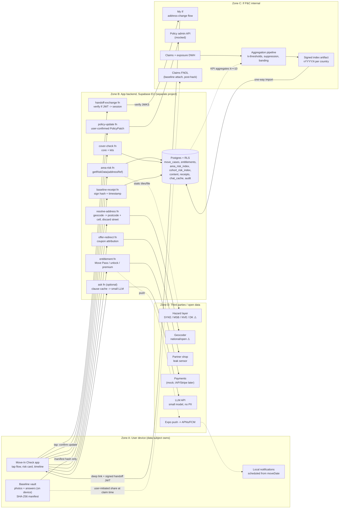
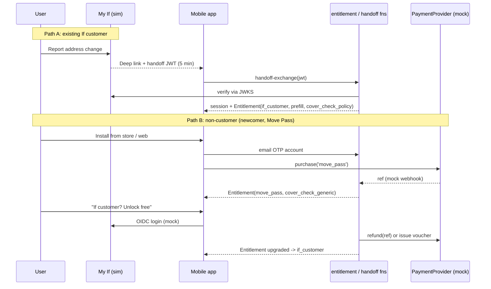

# Architecture: "Move-In Check": a first-week companion for people moving home, built on If's own data

> Junction hackathon · If P&C Insurance challenge · Stack: React Native (Expo) + Supabase (EU). Conventions follow `heymom/docs/architecture.md`.
> Status: design only, no code yet. Unverified external facts are marked ⚠️. **All If data in the demo is SYNTHETIC and labelled "Simulated If data" in the UI.**

## 0. Concept in one paragraph

Sara and Mikko are moving from a rented 52 m² apartment in Tampere (built 2012) to a 120 m² detached house in Espoo that they bought (built 1979, basement, sauna). They have If home insurance. When Sara reports the address change in **My If**, she gets **Move-In Check**. It opens with her profile already filled in from the policy and asks a few tap-only questions. It then shows a **risk card comparing the old and new home** (Low/Med/High per physical peril, built from If's internal **aggregated** claim statistics), a **timeline checklist** (2 weeks before / moving day / first week) with 6-10 checks chosen by rules, and a **cover check** ("you now own a detached house, but your policy covers contents only"). Any needed policy change is made with one tap. Along the way Sara builds a **move-in baseline**: timestamped photos and answers that stay on her phone. The app seals them with a signed hash receipt. Three months later a stain appears under the sink. The question "was this pre-existing?" is answered with one tap, at the moment Sara chooses to file. Insurance stays in the background. The life event comes first.

## 0.1 Decisions at a glance

| Area | Decision |
|---|---|
| Core data | **If-owned assets only:** policy profile (existing customers), aggregated area/cohort claim index, If's public T&Cs per country, partner network, and the My If address-change touchpoint. Public data is limited to **one national flood/stormwater layer per country** behind an adapter. It is optional, and in the demo it is a static file |
| RN flavour | **Expo managed + dev builds (EAS), expo-router**, same as heymom |
| Backend | **Supabase EU (Stockholm eu-north-1; Frankfurt fallback)**. This is a separate project from If core systems. It provides Postgres + RLS, Edge Functions (Deno) and pg_cron |
| Data location | **Device-first.** Photos, free-text answers and the baseline stay on the device. The server holds entitlement, postcodes, move date, tap-answers needed for the cover check, and baseline *hashes* |
| Logic | **Deterministic shared `kits` engine** (JSON rules: questions, checklist, cover flags, offer, "did you know?") + pure `core` for risk-card composition. **No per-user LLM output** |
| Risk index | **Two tiers.** (a) *Area index* (postcode, with rollup) for external perils: stormwater/flood and storm. (b) *Cohort index* (country × building type × construction decade × heating) for internal perils: water leak and fire. **Only bands are exported**, never frequencies |
| Fairness | **Physical perils only.** Burglary gets **no area score**, only "protect your home on moving day" tips driven by home attributes |
| Input UX | **Tap-based multiple choice** driven by kit questions. No empty chatbot. The optional "Ask a question" uses cached answers per T&C clause, falls back to a small model, and is the first item on the cut list |
| Identity | Customers: **signed handoff token from My If** (no If credentials in the app). Non-customers: Supabase email/OTP account + Move Pass |
| Monetisation | Free for If customers · **Move Pass** one-time fee for non-customers with "If customer? Unlock free" · optional **Premium** for landlords/frequent movers. Payments are **mocked** |
| Baseline proof | SHA-256 manifest of photos and answers, **signed with a server timestamp**. The server never sees the photos |
| Countries | Country surface = kit overlay JSON + T&C clause JSON + i18n + partner list + one `HazardLayerAdapter` |
| Locales | en / fi / sv (shared `i18n` package). Newcomers to Finland (en) are a secondary audience via Move Pass |

> **Credibility point (say it openly in the pitch):** We do not have If's data, and nobody gets to see individual claims. The design specifies the *export contract* If would produce internally (banded, k-thresholded, suppressed). The demo runs on a synthetic file that matches that contract. Swapping in the real file changes no app code.

---

## 1. Architecture overview



**Trust-boundary rules**

| Boundary | What crosses | What never crosses |
|---|---|---|
| C → A/B (handoff) | Short-lived (5 min) ES256 JWT: opaque `policyRef`, product code, profile fields (building type, year band, m², heating, tenure, deductible, covered extras), old/new postcode, move date, locale | Policy number, personal ID number (henkilötunnus), claim history, premium, other household members |
| A → B | Postcodes and grid cells, tap answers needed for the cover check, baseline **hash** | Photos, free text, precise coordinates, street address (resolved, then discarded) |
| B → C | User-confirmed `PolicyPatch` (the same fields My If's change form asks for) + `policyRef`. Aggregate KPIs (k ≥ 10) | Checklist answers, risk-card views, baseline content, offer clicks per person. **Nothing feeds pricing or underwriting** |
| C → B (index) | Signed, versioned, **banded** index rows | Frequencies, counts, claim rows, anything below thresholds |
| B → D | Geocoder: address string (not stored). LLM: question text with PII stripped + clause text. Partner: coupon code only | Identity, policy data, address |
| A → C (claims) | Baseline pack (photos + manifest + receipt), **only when the user chooses to attach it** | Automatic upload. If may not request it as a condition |

---

## 2. Monorepo layout (pnpm workspaces, `node-linker=hoisted` for Metro)

```
moving/
├─ apps/
│  ├─ mobile/                         # Expo app, expo-router
│  │  ├─ app/(entry)/                 # handoff landing, Move Pass paywall, "If customer? unlock free"
│  │  ├─ app/(setup)/                 # tap questions (kit-driven), confirm prefilled profile
│  │  ├─ app/(move)/                  # risk card, timeline, checklist item, cover check, offer
│  │  ├─ app/(baseline)/              # in-app camera capture, vault, seal, export/share pack
│  │  ├─ app/(ask)/                   # optional clause Q&A
│  │  └─ src/{vault,notifications,api,state}/
│  └─ demo-console/                   # Vite web: "My If simulator" (address change -> QR/deep link),
│                                     #   sim clock (+3 months), claims-handler view (verify baseline),
│                                     #   index inspector (shows suppression/rollup), judge QR
├─ supabase/
│  ├─ migrations/                     # schema, RLS, views, retention purges (pg_cron)
│  ├─ functions/
│  │  ├─ handoff-exchange/  resolve-address/  area-risk/  cover-check/  policy-update/
│  │  ├─ entitlement/  baseline-receipt/  offer-redirect/  ask/  kpi-rollup/  health/
│  │  └─ _shared/{core,kits}/         # GENERATED copies (Deno bundling workaround, as heymom)
│  └─ seed/                           # synthetic index import, content, demo users
├─ packages/
│  ├─ core/                           # domain types, risk-card composer, band math, cover diff,
│  │                                  #   baseline manifest hashing. Zero deps
│  ├─ adapters/                       # PolicyProfileProvider (if-handoff | mock), AreaRiskProvider
│  │                                  #   (if-index | synthetic), HazardLayerAdapter (fi-syke | static),
│  │                                  #   Geocoder, PaymentProvider (mock), PartnerCatalog, ChatModel
│  ├─ kits/            [SHARED]       # JSON rules + question-flow evaluator (same engine as heymom)
│  ├─ i18n/            [SHARED]       # fi, sv, en; ICU messages; plain-language B1
│  ├─ ui/              [SHARED]       # accessible components: TapChoice, RiskRow, LevelBadge
│  │                                  #   (colour + text + icon), TimelineStep, BigButton
│  └─ content/                        # T&C clause JSON per country/product, checklist catalogue,
│                                     #   did-you-know lines, partner offers per country
├─ kits/move-in-check.v1.json         # base kit; overlays in kits/overlays/{FI,SE,NO,DK}.json
├─ tools/
│  ├─ synth-index/                    # deterministic synthetic index generator (seeded)
│  └─ index-validator/                # checks any index artifact against the export contract
├─ data/
│  ├─ synthetic/if-area-risk-2026.1-FI.json   # simulated: true
│  └─ hazard/fi-stormwater-demo.json          # static demo layer for 2-3 cities
└─ scripts/{sync-core.ts, sync-shared.ts}
```

**Shared across the team's three apps (heymom, moving, third app):** `@team/ui`, `@team/i18n`, `@team/kits`, plus a tiny `@team/base` (Country, Locale, ISO, Clock). Hackathon: copy from heymom at hour 0, tag `SHARED from heymom@<sha>`, and diff with `sync-shared.ts`. Post-hack: extract into one shared repo published to GitHub Packages.

---

## 3. Domain model (`packages/core/src/types.ts`)

```ts
type ISO = string;                                   // UTC ISO-8601
type Country = 'FI' | 'SE' | 'NO' | 'DK';
type Locale = 'fi' | 'sv' | 'en';
type RiskLevel = 'low' | 'medium' | 'high';
type ScoredPeril = 'water_leak' | 'stormwater_flood' | 'fire' | 'storm';   // physical only
type TipPeril = 'burglary';                                                 // never area-scored
type Phase = 'two_weeks_before' | 'moving_day' | 'first_week';
type FieldSource = 'policy' | 'user' | 'default';

interface AddressRef {                               // the only address form stored server-side
  country: Country;
  postcode: string;                                  // '02100'
  municipalityCode: string;
  regionCode: string;
  gridCell1km?: string;                              // for hazard layer lookup only
}

interface PolicyProfile {                            // from My If handoff JWT; customers only
  policyRef: string;                                 // opaque, rotating; NOT the policy number
  country: Country;
  product: 'home_contents' | 'home_contents_building' | 'apartment_owner' | 'tenant';
  termsVersion: string;                              // T&C clause pack key, e.g. 'FI-HOME-2026-01'
  insuredPostcode: string;
  buildingType: BuildingType;
  yearBuiltBand: YearBand;
  livingAreaM2: number;
  heating: Heating;
  tenure: 'owner' | 'tenant';
  deductibleEur: number;
  waterDeductibleOptionAvailable: boolean;
  coveredExtras: { storageUnit: boolean; cabin: boolean; highValueItems: boolean };
  validUntil: ISO;
}

type BuildingType = 'apartment_block' | 'row_house' | 'semi_detached' | 'detached' | 'cabin';
type YearBand = 'pre1960' | '1960s' | '1970s' | '1980s' | '1990s' | '2000s' | '2010plus';
type Heating = 'district' | 'electric' | 'heat_pump' | 'oil' | 'wood' | 'other' | 'unknown';

interface HomeProfile {                              // NEW home; prefilled "same as before?" then taps
  address: AddressRef;
  buildingType: BuildingType;
  yearBuiltBand: YearBand;
  livingAreaM2: number;
  heating: Heating;
  tenure: 'owner' | 'tenant';
  floorLevel?: 'basement' | 'ground' | 'upper';
  features: { basement: boolean; sauna: boolean; fireplace: boolean; dishwasher: boolean;
              washingMachine: boolean; floorDrain: boolean; leakSensor: boolean };
  pipesRenovatedAfter2000?: boolean | 'unknown';     // putkiremontti / stambyte
  keepsStorageUnit: boolean;
  hasCabin: boolean;
  oldHomeHeldUntil?: ISO;                            // overlap period
  sources: Partial<Record<keyof Omit<HomeProfile, 'sources' | 'address'>, FieldSource>>;
}

interface MoveCase {
  id: string;
  userId: string;
  entitlementId: string;
  origin: 'my_if_address_change' | 'move_pass' | 'premium_property';
  country: Country;
  locale: Locale;
  from?: AddressRef;
  to: AddressRef;
  moveDate: ISO;                                     // local date at 00:00 in country tz
  phase: Phase | 'done';
  kitRef: { kitId: 'move-in-check'; version: number; overlay: Country };
  answers: Record<string, string | number | boolean>;   // tap answers only; no free text
  policy?: PolicyProfile;
  home: HomeProfile;
  createdAt: ISO;
  expiresAt: ISO;                                    // moveDate + 90 d, then purge
}

/** Exported by If's pipeline. Bands only. See §5 for the contract. */
interface AreaRiskRow {
  country: Country;
  unitType: 'postcode' | 'municipality' | 'region' | 'country';
  unitId: string;
  peril: Extract<ScoredPeril, 'stormwater_flood' | 'storm'>;
  band: RiskLevel;
  confidence: 'high' | 'medium' | 'low';
  rolledUpFrom?: 'postcode' | 'municipality';        // set when the finer unit was suppressed
  indexVersion: string;                              // '2026.1-FI'
}
interface CohortRiskRow {
  country: Country;
  buildingType: BuildingType;
  yearBand: YearBand;
  heating: Heating | '*';
  peril: Extract<ScoredPeril, 'water_leak' | 'fire'>;
  band: RiskLevel;
  confidence: 'high' | 'medium' | 'low';
  indexVersion: string;
}
interface AreaRiskIndex {
  manifest: IndexManifest;                           // §5
  area: AreaRiskRow[];
  cohort: CohortRiskRow[];
}

interface PerilScore {
  peril: ScoredPeril;
  level: RiskLevel | 'unknown';
  basis: Array<'if_area' | 'if_cohort' | 'public_hazard' | 'home_attribute'>;
  modifiers: Array<{ key: string; delta: -1 | 1; reasonKey: string }>;  // e.g. pipes renovated -1
  whatIf?: { key: 'leak_sensor' | 'auto_shutoff'; level: RiskLevel };  // drives the one offer
  confidence: 'high' | 'medium' | 'low';
  simulated: boolean;                                // true for synthetic index -> UI badge
  explanationKey: string;                            // "Homes like this (1970s detached) ..."
}

interface RiskCard {
  moveCaseId: string;
  old?: { address: AddressRef; scores: PerilScore[] };    // absent for Move Pass without old address
  new: { address: AddressRef; scores: PerilScore[] };
  deltas: Array<{ peril: ScoredPeril; direction: 'up' | 'down' | 'same' }>;
  burglaryTips: Array<{ tipKey: string; reason: 'moving_day' | 'old_keys' | 'ground_floor' | 'storage_unit' }>;
  didYouKnowKey: string;                             // exactly one line, chosen by kit rule
  coverageGaps: CoverCheckFlag[];                    // severity 'gap' only
  indexVersion: string;
  hazardLayerVersion?: string;
}

interface ChecklistItem {
  id: string;                                        // 'find_water_shutoff'
  phase: Phase;
  peril: ScoredPeril | TipPeril | 'admin';
  titleKey: string; bodyKey: string;
  priority: number;                                  // 1 = highest
  estMinutes: number;
  evidence: 'photo' | 'answer' | 'photo_and_answer' | 'none';
  answerOptions?: string[];                          // tap choices, e.g. ['dry', 'damp', 'not_sure']
  baseline: boolean;                                 // goes into the sealed baseline
  ruleId: string;                                    // traceability: "why am I seeing this?"
  offerSlot?: boolean;                               // may host the single partner offer
}

interface BaselineEntry {
  checklistItemId: string;
  answer?: string;
  photos: Array<{ localUri: string; sha256: string; capturedAt: ISO;
                  source: 'in_app_camera'; exifLocationStripped: true; cloudPath?: string }>;
}
interface MoveInBaseline {
  id: string; moveCaseId: string;
  entries: BaselineEntry[];
  manifestSha256: string;                            // canonical JSON of entries (without URIs)
  receipt?: BaselineReceipt;
  storage: 'device_only' | 'device_and_encrypted_backup';
  sealedAt?: ISO;
}
interface BaselineReceipt {                          // server never sees photos
  manifestSha256: string;
  serverTime: ISO;                                   // proves "existed no later than"
  keyId: string;
  signature: string;                                 // Ed25519 over (hash || serverTime || keyId)
}

type CoverFlagKind =
  | 'building_cover_needed'      // tenant/apartment -> owner of detached house
  | 'size_increase'              // new m² > insured m² × threshold
  | 'building_type_change'
  | 'overlap_period'             // both homes held; country clause on cover during move ⚠️
  | 'storage_unit_not_covered'
  | 'cabin_not_covered'
  | 'tenant_owner_responsibility_shift'
  | 'water_deductible_option'
  | 'high_value_items_review';
interface CoverCheckFlag {
  id: string; kind: CoverFlagKind;
  severity: 'info' | 'action' | 'gap';
  messageKey: string; params: Record<string, string | number>;
  clauseRef: { country: Country; termsVersion: string; clauseId: string };  // links to If's public T&C
  action?: { type: 'policy_update'; patch: PolicyPatch }
         | { type: 'get_quote'; product: string }          // non-customers / new product
         | { type: 'learn_more' };
  ruleId: string;
}
interface PolicyPatch {                              // same fields My If's change form asks
  policyRef: string;
  changes: Partial<Pick<PolicyProfile, 'livingAreaM2' | 'buildingType' | 'tenure' | 'product'>>
         & { addExtras?: Array<'storageUnit' | 'cabin' | 'waterDeductibleReduction'> };
  effectiveFrom: ISO;
  userConfirmedAt: ISO;                              // no change without explicit tap
}

interface Offer {
  id: string; partnerId: string; country: Country;
  titleKey: string; priceEur: number; customerDiscountPct?: number;
  perilTargets: ScoredPeril[];                       // 'water_leak'
  eligibilityRuleId: string;
  disclosureKey: string;                             // "If may receive a fee from this partner."
  redirect: { kind: 'coupon'; codeTemplate: string };   // no personal data to partner
  deductibleBenefitKey?: string;                     // e.g. lower water deductible with sensor ⚠️ product decision
}

type EntitlementKind = 'if_customer' | 'move_pass' | 'premium';
interface Entitlement {
  id: string; userId: string; kind: EntitlementKind;
  status: 'active' | 'expired' | 'refunded' | 'upgraded';
  moveCaseQuota: number;                             // customer: 1 per address change; pass: 1; premium: n properties
  features: Array<'prefill' | 'cover_check_policy' | 'cover_check_generic' | 'risk_card'
                 | 'timeline' | 'baseline' | 'baseline_handover_share' | 'ask'>;
  validFrom: ISO; validTo: ISO;
  payment?: { provider: 'mock' | 'iap' | 'stripe'; ref: string; amountEur: number };
  upgradedTo?: string;                               // move_pass -> if_customer
}

interface Clock { now(): Date }                      // demo: sim clock (+3 months jump)
```

**Provider interfaces (`packages/adapters`)**

```ts
interface AreaRiskProvider {                          // the single data function
  getRiskData(addr: AddressRef, home: Pick<HomeProfile, 'buildingType' | 'yearBuiltBand' | 'heating'>):
    Promise<{ area: AreaRiskRow[]; cohort: CohortRiskRow[]; hazard?: HazardHit; indexVersion: string; simulated: boolean }>;
}
interface HazardLayerAdapter {                        // at most one per country
  country: Country; id: 'fi-syke-flood' | 'se-msb' | 'no-nve' | 'dk-klimadata' | 'static-demo';
  lookup(cell: string): Promise<HazardHit | null>;   // { kind: 'flood_1in100' | 'stormwater_depression', version }
}
interface PolicyProfileProvider { fromHandoff(jwt: string): Promise<PolicyProfile> }   // if-handoff | mock
interface PolicyUpdateProvider { submit(p: PolicyPatch): Promise<{ status: 'accepted' | 'needs_review'; newPremiumEurMonthly?: number }> }
interface PaymentProvider { purchase(sku: 'move_pass' | 'premium_year'): Promise<{ ref: string }>; refund(ref: string): Promise<void> }
interface ChatModel { answer(q: string, clauses: Clause[], locale: Locale): Promise<string> }
```

---

## 4. Risk card composition (pure, `core/riskCard.ts`)

| Row | Source | Home-attribute modifiers (±1 band, clamped) | Shown as |
|---|---|---|---|
| **Water from inside** (pipes, appliances) | If **cohort** band (building type × decade × heating) | pipes renovated after 2000: −1 · dishwasher + washing machine without sensor: +1 (only if cohort is low) · leak sensor/auto shut-off: −1 | Level + "what-if with leak sensor" toggle (the offer hook) |
| **Flood & stormwater** | If **area** band (postcode → rollup) + hazard layer hit (raises to at least `medium`; `high` if 1-in-100 flood zone ⚠️) | basement/floor drain: +1 · upper floor: −1 | Level + "basement? floor drain?" tip |
| **Fire** | If **cohort** band | sauna, fireplace, wood heating: +1 · smoke alarm tested (checklist): note only, no change | Level |
| **Storm** | If **area** band | apartment block: −1 · detached with large trees (tap): +1 | Level |
| **Burglary** | **No score** | moving-day open doors, old keys in circulation, ground floor, storage unit | "Protect your home" tips only |

- **Old vs new:** the same function runs for both addresses. Arrows show direction only.
- **"Did you know?"** One line is picked by a kit rule. Example: "Most home water damage comes from pipes and appliances, not weather" (from the research doc). Example: "about 70 % of water damage happens in summer, per If ⚠️ (verify the source wording before quoting)".
- **Confidence:** a row built from rolled-up data says "Based on your wider area".
- **Low confidence:** with low confidence and no hazard hit, the level is shown as `unknown` with the text "not enough data". It never falls back to a guess.
- Every level is shown as **colour + word + icon** and is screen-reader labelled ("Water from inside: high, up from low").

---

## 5. Area risk index pipeline (inside If, Zone C)

### 5.1 How If would build it

```
Claims DWH + policy exposure (5-year rolling window)
  │ 1. SELECT home claims; map If cause codes -> {water_leak, stormwater_flood, fire, storm}
  │    EXCLUDE: injury/liability/health, theft/burglary, contested/fraud-flagged, motor
  │ 2. Exposure = policy-years per unit; claims = count per unit (no amounts exported)
  ▼
Aggregate per unit
  area:   postcode × {stormwater_flood, storm}
  cohort: country × buildingType × yearBand × heating × {water_leak, fire}
  ▼
Disclosure control (all must pass, else roll up postcode -> municipality -> region -> country)
  • households (distinct policies) in unit      >= 50
  • claims in unit                               >= 10   (k-threshold)
  • distinct buildings with a claim             >= 5    (one apartment-block flood ≠ area signal)
  • largest single event share of claims        <= 50 % (dominance rule; e.g. one cloudburst)
  ▼
Credibility shrinkage toward parent unit
  rate* = Z·rate_unit + (1−Z)·rate_parent,   Z = exposure / (exposure + K)   (K tuned by actuaries)
  ▼
Banding relative to the national rate for the peril
  ratio < 0.80 -> low · 0.80–1.25 -> medium · > 1.25 -> high
  hysteresis: a unit changes band only if it crosses the boundary by > 0.05 for 2 consecutive refreshes
  confidence from Z: Z >= 0.7 high, 0.4–0.7 medium, else low
  ▼
Export artifact if-area-risk-{YYYY.N}-{CC}.json + manifest (sha256, Ed25519 signature)
  -> one-way push to app backend; app imports into area_risk_index / cohort_risk_index tables
```

| Concern | Design |
|---|---|
| Granularity | Postcode at the finest level (FI ≈ 3,000 postcode areas ⚠️). Some FI postcodes have very few residents ⚠️, and the rollup handles them. No street or building level |
| Differencing attack (diff two versions to find one claim) | Bands only, hysteresis, **yearly refresh** (quarterly at most), a 5-year window so one claim moves a rate very little |
| Linkage with public data | No counts, rates or amounts exported. Bands are coarse, and suppressed units become a parent value, not "blank" (blank would leak "few claims") |
| Commercial sensitivity | Bands relative to the national mean, not loss costs, so nothing can be reverse-engineered into tariffs |
| Pricing firewall | The pipeline is a **one-way, read-only** derivation. App-side data never flows back. The index is not a pricing input. If's tariff models are separate, and the governance doc states this |
| Versioning | `version = YYYY.N-CC`. App keeps the current and previous version. `RiskCard.indexVersion` is stored with each MoveCase so a user's card is reproducible |
| Validation | `tools/index-validator` rejects any artifact containing numeric rates, rows below thresholds, scored burglary, or an unsigned manifest |

### 5.2 Export contract

```ts
interface IndexManifest {
  indexId: 'if-area-risk';
  version: string;                       // '2026.1-FI'
  country: Country;
  generatedAt: ISO;
  windowYears: 5;
  perils: { area: ['stormwater_flood', 'storm']; cohort: ['water_leak', 'fire'] };
  disclosure: { minHouseholds: 50; minClaims: 10; minBuildings: 5; maxEventShare: 0.5 };
  banding: { lowBelow: 0.8; highAbove: 1.25; hysteresis: 0.05 };
  simulated: boolean;                    // MUST be true for the demo file
  sha256: string; keyId: string; signature: string;
}
```

### 5.3 Synthetic generator for the demo (`tools/synth-index`)

- **Keys:** real postcode list and municipality codes (Statistics Finland Paavo postcode areas, open licence ⚠️ verify CC BY 4.0) so lookups behave realistically. No real insurance values.
- **Calibration:** national water-leak claim frequency about 1 %/yr. This comes from about 22-30k household water claims/yr (research doc) over about 2.7M households ⚠️. Average water claim about €3,600, derived from >€90M / ~25k.
- **Cohort shape:** water leak peaks for 1970s-80s buildings (ageing pipes before renovation ⚠️ plausible, not verified). Fire is higher with wood heating, fireplace or sauna.
- **Area shape:** stormwater hotspots overlap the static demo hazard layer cells plus a seeded random field. Storm is higher on coastal and archipelago postcodes.
- **Generation:** it simulates *claims and exposure*, then runs the **same disclosure + banding code** as §5.1, which is the real pipeline's reference implementation. Suppression and rollup are therefore demonstrable (index inspector in the demo console).
- **Determinism and labels:** a fixed seed gives a reproducible demo. `simulated: true` drives the "Simulated If data" badge on every risk card.

---

## 6. Rules engine (`@team/kits`, shared with heymom)

One zero-dependency evaluator handles **question flow + rules**. Heymom's Life Kit (3 questions → household config) uses the same engine.

```ts
interface Kit {
  kitId: string; version: number; country?: Country;          // overlays merged via JSON Merge Patch
  limits: { checklistMin: 6; checklistMax: 10; offersMax: 1; didYouKnowMax: 1 };
  questions: Question[];                                        // tap-only UI is generated from these
  rules: Rule[];
}
interface Question {
  id: string; fact: string;                                     // 'home.features.basement'
  type: 'single' | 'multi' | 'number_bucket' | 'confirm_prefill';
  options: Array<{ value: string | number | boolean; labelKey: string }>;
  askIf?: Cond;                                                 // skip logic
  prefillFrom?: string;                                         // 'policy.buildingType' -> "Still a detached house?"
}
type Cond =
  | { all: Cond[] } | { any: Cond[] } | { not: Cond }
  | { eq: [string, unknown] } | { in: [string, unknown[]] }
  | { gt: [string, number | string] } | { lt: [string, number | string] }
  | { ratioGt: [string, string, number] }                      // a/b > n  (size increase)
  | { dateBefore: [string, string] }                            // overlap periods
  | { truthy: string };
interface Rule {
  id: string; when: Cond; priority: number;
  emit: Array<
    | { type: 'checklist'; itemId: string }
    | { type: 'flag'; kind: CoverFlagKind; severity: CoverCheckFlag['severity']; clauseId: string; patch?: object }
    | { type: 'offer'; offerId: string; score: number }
    | { type: 'didYouKnow'; key: string; score: number }>;
}
function evaluate(kit: Kit, facts: Facts):
  { checklist: ChecklistItem[]; flags: CoverCheckFlag[]; offer?: Offer; didYouKnow: string; trace: RuleTrace[] };
```

**Semantics**

| Aspect | Behaviour |
|---|---|
| Purity | Pure and deterministic. Same facts + kit version → same output. Snapshot-tested per segment |
| Facts available | `policy.*`, `old.*`, `home.*`, `answers.*`, `risk.<peril>` (levels from §4) |
| Checklist selection | Sorted by priority, de-duplicated, then trimmed to `limits`. Must-haves (water shut-off, smoke alarm) are pinned before trimming |
| Offer | Highest score wins. **Max 1**, and never in the cover-check screen (keeps advice separate from selling) |
| Trace | Feeds a "Why am I seeing this?" line on every item and flag |

**Example rules (base kit)**

```json
{ "id": "pipes_7080", "priority": 2,
  "when": { "all": [ { "in": ["home.yearBuiltBand", ["1970s","1980s"]] },
                     { "not": { "eq": ["home.pipesRenovatedAfter2000", true] } } ] },
  "emit": [ { "type": "checklist", "itemId": "under_sink_moisture" },
            { "type": "checklist", "itemId": "appliance_hoses" },
            { "type": "offer", "offerId": "leak_sensor_autoshutoff", "score": 90 } ] }

{ "id": "tenant_to_detached_owner", "priority": 1,
  "when": { "all": [ { "eq": ["policy.tenure","tenant"] }, { "eq": ["home.tenure","owner"] },
                     { "eq": ["home.buildingType","detached"] } ] },
  "emit": [ { "type": "flag", "kind": "building_cover_needed", "severity": "gap",
              "clauseId": "FI-HOME.scope.building", "patch": { "product": "home_contents_building" } } ] }

{ "id": "size_up", "priority": 1,
  "when": { "ratioGt": ["home.livingAreaM2", "policy.livingAreaM2", 1.2] },
  "emit": [ { "type": "flag", "kind": "size_increase", "severity": "action", "clauseId": "FI-HOME.sum_insured" } ] }
```

**Checklist catalogue (`packages/content`, about 25 items; 6-10 selected)**

| Phase | Items (baseline photo = 📷 is not used; marked **[B]**) |
|---|---|
| 2 weeks before | Check cover dates & overlap · Keep or end the storage unit? · Photograph valuables + keep receipts (proof of ownership) · Tenants: ask the landlord when pipes were last renovated |
| Moving day | **[B]** Find the water main shut-off, photo · **[B]** Under-sink cabinet, photo + dry/damp · **[B]** Bathroom floor & drain, photo · Never leave the van or doors open unattended (burglary tip) · Old keys: ask whether locks were changed |
| First week | Test smoke alarms (resident duty in FI ⚠️) · **[B]** Dishwasher/washing-machine hoses & valves · Clean the floor drain · Detached: gutters & downpipes away from the foundation · Sauna/fireplace: clearances and chimney sweep date · Save If's claim contact |

Each item has a **local notification** scheduled on the device relative to `moveDate`. No server push is needed, so the cost is zero.

**Cover check thresholds and clauses** live in `content/terms/{CC}/{termsVersion}.json`: `sizeIncreaseRatio`, `overlapCoverDays` ⚠️ (verify If FI's actual cover during a move), `storageUnitCovered`, and others. The country surface is data, not code.

---

## 7. Entitlements & monetisation (payments mocked)



| Feature | If customer (free, included) | Move Pass (one-time, **€9.90 assumption**) | Premium (landlord / frequent mover, **€39/property/yr assumption**) |
|---|---|---|---|
| Risk card old vs new | Yes, prefilled | Yes (old address optional) | Yes, per property |
| Prefilled profile | Yes | No (taps) | No |
| Cover check | Policy-specific + one-tap update | Generic "questions to ask your insurer" + **"Get an If quote"** lead | Per property; landlord vs tenant responsibilities |
| Timeline + baseline + receipt | Yes | Yes | Yes + **shareable handover report** (move-in/move-out, deposit disputes) |
| Ask a question | Yes | Yes (5/day) | Yes |
| Partner offer | 1 (customer discount) | 1 | 1 per property |

- **Enforcement:** entitlements are checked **server-side** in every function, with RLS on `entitlements` (`user_id = auth.uid()`). The client only reflects them.
- **Payment reality ⚠️:** Apple/Google rules likely treat Move Pass as digital content, which means IAP. Post-hack options are store IAP, or selling it on the web through If's site.
- **Product trade-off to flag:** charging non-customers may lower lead volume. Option: make Move Pass free with "get an If quote" and A/B test post-hack. For the demo, keep the fee because the user wants that model.

---

## 8. Privacy & fairness architecture

### 8.1 Purposes and lawful bases (flag all for **gdpr-expert**)

| # | Purpose | Data | Proposed basis | Note |
|---|---|---|---|---|
| P1 | Provide Move-In Check to an If customer | policyRef, profile fields, postcodes, tap answers | **Contract** 6(1)(b) if the feature is part of the home policy service; otherwise **legitimate interest** 6(1)(f) | ⚠️ decide: is the app part of the contract? |
| P2 | One-tap policy update | PolicyPatch | **Contract** 6(1)(b), user-initiated | No change without an explicit tap; If's normal underwriting applies |
| P3 | Prevention nudges for existing customers (first-week reminders) | moveDate, phase | **Legitimate interest** 6(1)(f) with LIA + one-tap opt-out | Reminders are local notifications. Server push only for re-engagement |
| P4 | Baseline photos & answers | photos, answers | **Device-only:** the controller does not process them. **Cloud backup:** consent 6(1)(a). **Receipt hash:** contract / consent | Is a hash personal data? Treat it as pseudonymous personal data |
| P5 | Partner offer | none to partner (coupon code) | **Consent** for marketing display/notifications. Soft opt-in for existing customers ⚠️ (FI Information Society Code) | Disclosure: "If may receive a fee" |
| P6 | Non-customer account + Move Pass | email, purchase ref | **Contract** (purchase). **Consent** for marketing/quote follow-up | |
| P7 | Optional Q&A | question text (PII stripped) | Contract / consent | No personal data to the LLM; 30-day cache of normalised questions |
| P8 | Building the aggregate index (If internal) | claims + exposure | If's **legitimate interest** / compatible further processing for statistics (Art. 6(4), 89) ⚠️ | **Key question:** is the export anonymous (outside GDPR)? |
| P9 | Product KPIs to If | aggregate counts k ≥ 10 | Legitimate interest. No identifiers | Analytics SDK without device identifiers, or consent ⚠️ ePrivacy |
| Never | Pricing, underwriting, claims assessment, credit, marketing profiling | n/a | **Purpose limitation, stated in-app and in contract** | Technical firewall in §1 |

### 8.2 Data inventory & retention

| Datum | Location | Retention |
|---|---|---|
| Photos, answers, baseline | Device vault (app sandbox; export to the user's own Files/cloud) | Until the user deletes it. The app reminds them after 24 months |
| Encrypted backup (opt-in) | Supabase Storage EU, client-side encrypted (key on device / user passphrase) | Until deleted; 24-month reminder |
| Baseline receipts (hash + time + signature) | `baseline_receipts` | 10 years ⚠️ (claim limitation periods; gdpr-expert to confirm), or deleted with the account |
| MoveCase (postcodes, home profile taps, flags) | `move_cases` | moveDate + 90 days, then purged (pg_cron). Aggregates kept |
| Entitlements, payments | `entitlements` | Accounting law period ⚠️ (FI 6 yrs + current) |
| Street address | Not stored. Geocoded in memory by `resolve-address`, then dropped | 0 |
| Chat cache | `chat_cache` keyed by (country, termsVersion, locale, normalised question) | Answers: until the T&C version changes. Raw questions: 30 days |
| Audit log (policy updates, unlocks) | `audit_log` append-only | 12 months |

### 8.3 Baseline: the user owns it, and nobody can use it against them

- **Capture:** in-app camera only for [B] items. GPS EXIF is stripped. The capture time comes from the device.
- **Sealing:** sealed within the first 14 days. The server signs `sha256(manifest) + serverTime`. The receipt proves the photos **existed no later than** the seal time. It does not prove that the device time is true. Say exactly this in the pitch.
- **Sharing:** only the user can attach the pack to a claim, and If commits **never to require it** as a condition of a claim. If photos show existing damage, the app advises reporting it to the landlord or seller. That is a benefit to the user, not a trap.

### 8.4 Fairness decisions

| Decision | Justification |
|---|---|
| Physical perils only (water inside, flood/stormwater, fire, storm) | These are actionable with prevention. Hazard is physical, not social |
| **Burglary: no area score, ever** | Crime-rate area scores correlate with income and ethnicity and stigmatise neighbourhoods (redlining optics; Finnish Non-Discrimination Act exposure ⚠️). Claim rates also reflect reporting behaviour. Moving-specific tips (open doors, old keys, storage units) are more useful than a rank |
| Internal perils use **building cohort**, not neighbourhood | Pipe leaks depend on building age and type, not on who lives nearby. This also lowers re-identification risk |
| No "good/bad area" ranking or map view | Only your own two addresses are shown, never a browsable map or league table (it would invite scraping and stigma) |
| Rate-limited lookups (20 postcodes/day/user) and no bulk API | Prevents rebuilding the whole index from the app |

### 8.5 Open questions for the gdpr-expert agent

1. Is the banded, thresholded index export **anonymous data** (outside GDPR) given the Recital 26 "means reasonably likely" test? Are the thresholds (50 / 10 / 5 / 50 %) sufficient?
2. Is building the index from claims data compatible further processing (Art. 6(4)), or does it need a separate basis or DPIA?
3. Contract vs legitimate interest for P1, given that the app is "included" in the policy.
4. Soft opt-in for partner offers to existing customers under Finnish/Swedish/Norwegian/Danish ePrivacy rules.
5. Is the baseline hash receipt personal data? What is the retention period, given claim limitation periods?
6. Controller split: who is the controller of the Move Pass (non-customer) data, If or a subsidiary?
7. How to state the "never used for pricing" commitment contractually and in the privacy notice. How it is audited.
8. Expected Art. 22 conclusion: not applicable (informational; the policy change is user-initiated and handled by If's standard process). Confirm.
9. LLM processor (US vendor?), transfer mechanism, and the PII-stripping sufficiency.
10. DPIA: expected not mandatory for the app (no special-category data, no systematic monitoring), but recommended for the index pipeline.

---

## 9. Hackathon MVP (48 h, 3-4 people)

### 9.1 Real vs mocked

| Real | Simulated / mocked |
|---|---|
| Expo app (dev build): tap flow, risk card old/new, timeline, cover check, baseline camera + vault + seal | **If area/cohort index:** synthetic, `simulated: true`, badge on screen |
| Supabase EU, RLS, all edge functions, entitlements server-side | **My If:** demo console page issuing a real ES256 handoff JWT (same verify path as production) |
| `@team/kits` engine + base kit + FI overlay; `core` risk composer | **Policy admin API:** mock that returns `accepted` + new monthly premium |
| Baseline SHA-256 manifest + **Ed25519 signed receipt** + verifier in the claims-handler view | **Payments:** mock provider (Move Pass, refund on unlock) |
| fi + en strings (sv for core screens) | **Hazard layer:** static demo file for 2-3 cities (derived from SYKE open data if the licence fits ⚠️, otherwise hand-drawn) |
| Local notifications from moveDate; sim clock for the +3-month jump | Geocoder: static lookup of the demo addresses |
| Index inspector showing suppression/rollup on synthetic data | Partner shop: static landing page + coupon code |
| | Ask a question: 15 cached clause answers. Live small-model fallback only if time allows (`claude-haiku-5-5` ⚠️ verify model ID/pricing) |

### 9.2 Demo script (≈ 4 min)

1. **(30 s) The trigger.** Demo console = "My If". Sara reports an address change: Tampere apartment → Espoo detached house. A deep link opens Move-In Check: "Moving on 1 Nov? Here's your first-week plan." Six taps follow, starting with "Still 2 people? Yes." and "New home: detached, 1979, basement, sauna." It is prefilled, with no typing and no chatbot.
2. **(45 s) The risk card flip.** Old vs new. Water from inside goes **Low → High** ("Homes like this: 1970s detached"). Flood & stormwater goes Low → Medium ("basement + floor drain"). Fire goes Low → Medium (sauna). Storm stays the same. The burglary row shows a moving-day tip, not a score. The "Simulated If data" badge is visible. One did-you-know line appears. Toggle "with leak sensor": water High → Medium. The single offer shows a leak sensor with customer price and disclosure.
3. **(45 s) The cover check.** Gap: "You now own a detached house. Your policy covers contents only." Action: 52 m² → 120 m². Info: "Keeping the Tampere storage unit until December? Not covered." **One tap** → mock If API → "Updated. New premium €X/month." Each flag shows the If T&C clause it comes from.
4. **(45 s) Moving day.** Timeline item "Find the water main shut-off", then a photo. "Under the sink: dry", photo. "Hoses", photo. Tap **Seal my move-in record** → receipt: "Sealed 3 Nov 2026 18:42, 9 photos, fingerprint 7f3a…". Message on screen: "Your photos never left your phone."
5. **(60 s) KILLER MOMENT: three months later.** The sim clock jumps to February. There is a stain under the sink. Sara taps "Report water damage" → FNOL draft prefilled, and she chooses **Attach move-in record**. The claims-handler view (console) verifies the hashes and signature: "Under-sink cabinet photographed DRY on 3 Nov 2026 (sealed). Damage is new." The question "was this pre-existing?" is settled in seconds instead of weeks. This ties to the research: missing documents delay claims, 22 % avoid filing, 25 % switch insurer after a bad claim.
6. **(30 s) Scale + business.** The index inspector shows a small postcode rolled up to municipality ("this is how If keeps it anonymous"). Slide: country surface = 4 JSON files + 1 adapter. Unit economics (§10). Close: "Physical risks only. Never used for pricing. Your photos stay yours."

**Backup:** a Move Pass newcomer path (en). Priya renting in Helsinki pays a mock €9.90, taps "If customer? Unlock free", and the pass is refunded.

### 9.3 Build order

| Hours | P1 Backend / data | P2 Mobile | P3 Kits / content / index | P4 Demo console / design / pitch |
|---|---|---|---|---|
| 0-4 | Supabase EU, schema, RLS, copy shared pkgs, `core` types | Expo dev build, router, `ui` TapChoice/LevelBadge | Kit schema + evaluator (from heymom), checklist catalogue draft | Persona, script, visual language for the risk card |
| 4-16 | handoff-exchange (JWT/JWKS), area-risk, index import | Setup tap flow, risk card old/new | `synth-index` + disclosure/banding code, FI overlay, T&C clause JSON | My If simulator (JWT issue, deep link/QR) |
| 16-28 | cover-check, policy-update mock, entitlement + mock payments | Timeline, checklist items, cover-check screen, offer | Rules for 4 segments, snapshot tests, did-you-know lines | Index inspector, claims-handler verifier |
| 28-36 | baseline-receipt (Ed25519), offer-redirect, retention jobs | Camera capture, vault, seal, FNOL attach, local notifications | fi/en strings, sv core screens, a11y labels | Pitch deck, unit economics slide |
| 36-48 | Hardening, seed reset, health | Accessibility pass (font scale, screen reader, contrast) | Ask-a-question cached answers (if time) | 10 rehearsals, backup video |

**Cut list (in this order):** live LLM fallback → Ask-a-question entirely → Swedish → Premium tier (slide only) → Move Pass path (slide only) → hazard layer (index only) → "what-if with sensor" toggle. **Never cut:** risk card flip, one-tap cover update, sealed baseline + claim-time verification.

---

## 10. Unit economics sketch (ALL ASSUMPTIONS, labelled)

### 10.1 Marginal cost per 1,000 users

| Item | Assumption | Cost / 1,000 users |
|---|---|---|
| Edge function calls | ~25 per user → 25k calls; within the plan quota ⚠️ | ≈ €0 |
| Postgres / index lookups | Index ≈ few MB; cached per postcode | ≈ €0 |
| Local notifications | On device | €0 |
| Push (re-engagement) | Expo push free tier ⚠️ | €0 |
| Encrypted photo backup | 30 % opt in × 15 MB = 4.5 GB × ~€0.02/GB-month ⚠️ | ≈ €0.10 / month |
| Ask a question | 20 % ask 3 Qs = 600 Qs; 80 % cache hit → 120 LLM calls × ~2k tokens on a small model ⚠️ | ≈ €0.30-0.60 |
| Geocoding | National/open geocoder ⚠️ | ≈ €0 |
| **Total marginal** | | **< €1 per 1,000 users** |
| Fixed | Supabase Pro ≈ $25/month ⚠️ + ops time | Dominates |

### 10.2 Value sketch (Finland only, annual)

| Driver | Assumptions | €/yr |
|---|---|---|
| Base | If FI home policies 600k ⚠️ · 12 % move/yr → 72k movers · 30 % adoption → **21.6k users** | n/a |
| Mover retention | Mover churn 15 % vs 8 % baseline ⚠️ · app cuts mover churn by 2 pp → 430 policies × LTV €225 (€300 premium, 15 % margin, 5 yrs) | ≈ €97k |
| Water-claim reduction | 1.2 %/yr water claim frequency among users → 260 claims · 10 % fewer (shut-off known, sensors, hoses) → 26 × €3,600 | ≈ €94k |
| Claims handling | Baseline cuts "pre-existing?" back-and-forth: €50 saved × 260 claims | ≈ €13k |
| Upsell from cover check | 3 % of users add building cover / larger sum → 650 × €60 extra premium margin | ≈ €39k |
| Partner fees | 5 % buy a sensor → 1,080 × €10 fee | ≈ €11k |
| Move Pass + leads | 5k passes × €9.90 = €50k · 5 % convert to If policy → 250 × €225 | ≈ €106k |
| **Total** | | **≈ €0.36M/yr FI**, versus a run cost of tens of €k/yr. ×4 Nordic countries at similar shape |

**Pitch framing:** most of the value comes from retention + fewer water claims. Both are measurable in a 6-month pilot with a holdout group of address-changers.

---

## 11. Post-hackathon path

1. **My If integration:** a real address-change event → handoff JWT (If IAM JWKS), and a real policy-change API behind `PolicyUpdateProvider` with If's existing change flow and price confirmation.
2. **Index pipeline in If's data platform:** owned by actuarial + data protection. Formal anonymisation assessment, threshold tuning, yearly refresh, signed artifacts.
3. **Claims loop:** a "Attach move-in record" field in FNOL. Handlers verify receipts with a public key. Measure handling-time delta.
4. **Pilot:** FI, 6 months, randomised holdout among address-changers. KPIs are mover retention, water claim frequency, cover-update rate and NPS.
5. **Nordic rollout:** for each country, a kit overlay + T&C clause pack + i18n (sv for SE/FI, add nb/da) + partner list + one hazard adapter (MSB/SMHI SE, NVE NO, DK climate data ⚠️). No code fork.
6. **Premium / landlords:** a landlord-tenant handover report built from two sealed baselines; a partnership angle with rental platforms.
7. **Trust upgrades:** an eIDAS qualified timestamp for receipts ⚠️, a third-party audit of the pricing firewall, a published methodology page.
8. **Shared repo:** extract `@team/ui`, `@team/i18n`, `@team/kits` and `@team/base` used by all three apps.

---

## 12. ADRs and risks

| # | Decision | Pros | Cons | Rejected alternatives |
|---|---|---|---|---|
| 1 | Build on If-owned data; public data ≤ 1 hazard layer per country | Scales across Nordics; unique to If; few integrations | Depends on If internal pipeline approval | Multi-registry area report (original concept): too broad, per-country integrations, weak conversion |
| 2 | Expo managed + dev builds, expo-router | Matches heymom; fast; camera/notifications built in | Native escape hatches via plugins | Bare RN, PWA (camera/vault UX weaker) |
| 3 | Supabase EU, separate project from If core | RLS, pg_cron, functions; EU region; pricing firewall is physical | Deno bundling needs `sync-core` | Hosting inside If systems (slow for a hackathon); Firebase |
| 4 | Device-first data; server stores minimum | Strong privacy story; near-zero storage cost | Device loss = baseline loss (mitigated by export / opt-in backup) | Cloud-first photo storage |
| 5 | Deterministic shared kits engine; no per-user LLM | €0 marginal; explainable traces; testable; reusable across 3 apps | Content authoring effort | LLM-generated reports (cost, hallucinated cover advice) |
| 6 | Two-tier index (area for external perils, cohort for internal), banded export | Matches the causal story (pipes ≠ neighbourhood); lower re-identification risk; no tariff leakage | Coarser; less "wow" than a heat map | Postcode index for all perils; raw frequencies |
| 7 | Burglary never area-scored | Fairness; no stigma; legal safety | Some users expect a "safe area" score | Crime-stat area ranking |
| 8 | Signed hash receipts; photos stay on device | Proves "existed by T" without If holding photos | Does not prove device clock; needs key management | Upload photos to If; blockchain anchoring (overkill) |
| 9 | Handoff via signed My If token | No credentials in app; prefill without a data copy | Requires My If work post-hack | Asking customers to log in again / re-enter data |
| 10 | Policy update via If API, explicit user tap, mocked | Credible end-to-end; no Art. 22 automation | Real API unknown ⚠️ | Deep link to a My If form only (weaker demo) |
| 11 | Index as versioned signed artifact imported into Postgres; server lookup | Revocable, reproducible, rate-limited | Needs connectivity | Shipping the full index in the app bundle (scraping, no revocation) |
| 12 | Q&A = cached clause answers + small model fallback, cut first | Cheap; grounded in T&C | Limited coverage | Open chatbot as the primary UI |
| 13 | Payments mocked; one offer max with disclosure | Honest; avoids the IAP rabbit hole | Real monetisation is unproven | Building real checkout in 48 h |

**Top risks**

| Risk | Mitigation |
|---|---|
| Judges think the synthetic data is real (or that we used If data) | Badge on every card, `simulated: true` in the contract, say it first in the pitch |
| "Can If legally build this index?" | Show the disclosure rules + inspector; name the open questions for gdpr-expert; no claim-level data anywhere |
| Re-identification via small postcodes / version diffs | Thresholds + building/event dominance rules + rollup + banding + hysteresis + yearly refresh + no bulk API |
| Neighbourhood stigma | Physical perils only, cohort for internal perils, no maps or rankings, burglary tips only |
| Baseline used against the customer | User-owned, voluntary attach, If commitment not to require it; advice to report existing defects |
| Wrong cover advice → liability | Every flag links to a T&C clause; wording "check / may"; the change is confirmed by If's system, not the app |
| Prefill wrong for the new home (policy describes the old one) | "Same as before?" confirm questions; `sources` tracked per field |
| My If / policy API realities differ ⚠️ | Adapters + mocks; the contract is defined so integration effort is scoped |
| Partner conflict of interest | One offer max, never inside the cover check, fee disclosure, customer discount |
| App-store IAP rules for Move Pass ⚠️ | Web purchase via If's site, or IAP; decide post-hack |
| Low adoption | Trigger sits inside the address-change flow customers already do; zero-typing setup |
| Demo fragility | Offline-capable kits/core, static geocoder/hazard, seeded reset, backup video |
| Country T&C variation | Clause packs per country/termsVersion; validator rejects flags without a clause |
